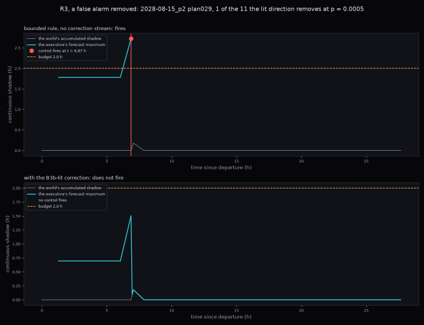
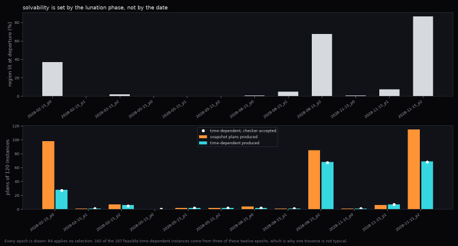
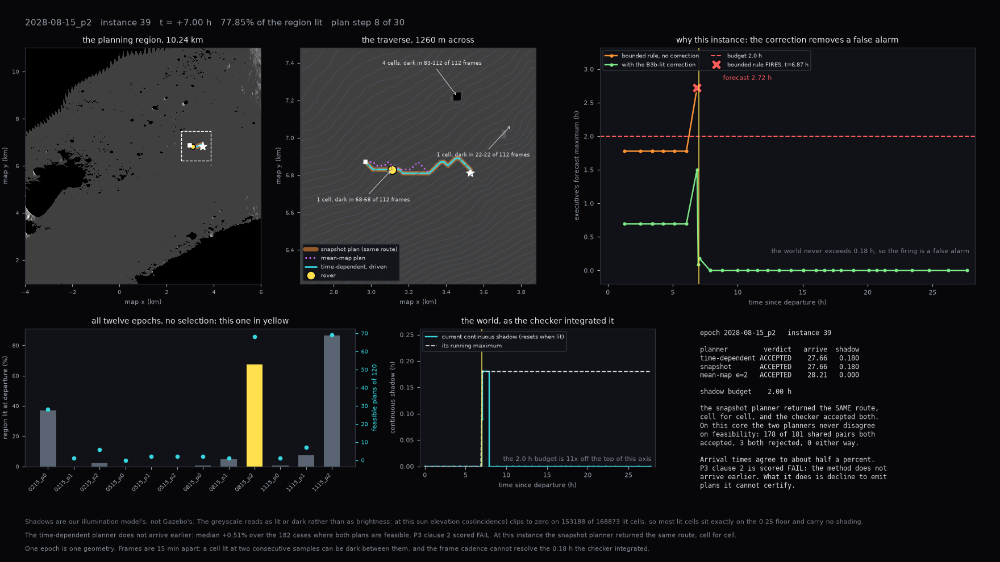

# lunar-polar-traverse

A time dependent path planner for a rover at the lunar south pole, on the real
LOLA 20 m DEM with a SPICE sun ephemeris, an independent C++ replay checker that
judges every plan, and an executive that watches the shadow budget while the plan
is being driven. The result splits: the premise the method rests on is measured
and holds, and the payoff it was supposed to buy is measured and does not
appear.


*The 10.24 km planning region over 27.66 h of one traverse, at the planner's own
0.25 h cadence. Grey is lit and black is dark, by our model and not by Gazebo.
The dashed box is the 1260 m window that Results shows close up; the path inside
it spans 560 m end to end.*

**In short.** The premise holds and the payoff does not, and both were registered
before they were measured. Shadow edges move at a median 185.31 m/hr, the same
order as a slow rover, so a path at this latitude is a schedule. Plans that
ignore that fail replay 63.3% of the time over 24 h. But where a time dependent
plan and a static baseline are both feasible, the time dependent one arrives
0.51% earlier at the median against a registered 10%, and paired per instance the
two planners' feasibility verdicts never disagree, 178 agreements and 3 shared
rejections on 181 shared instances, 0 either way. What the method buys is not a
faster traverse: it is that it declines to emit plans it cannot certify.

## What is here

* An illumination model: per cell horizon profiles from the DEM, swept against a
  SPICE sun vector, turned into lit and dark intervals over a 720 h horizon.
  Written twice, once in C++ for the ray march and once in Python as an
  independent reference, because a single implementation of a convention tests
  nothing.
* An exact label setting search in time over a directed 8 connected graph. A
  state is (cell, arrival time, continuous shadow time) and waiting is allowed
  in lit cells only, which is what makes its dominance rule sound. It is label
  setting rather than label correcting because time strictly increases. The
  graph is directed because slope cost depends on heading: pitch along the
  direction of travel and roll across it, so A to B is not B to A. A time
  expanded graph exists in this repository but is not the planner: it is the
  reference that check 3 searches exhaustively to confirm optimality on small
  instances.
* Two baselines that are not strawmen: a snapshot planner that sees illumination
  frozen at departure, and a mean map planner that sees a time averaged lit
  fraction, swept over its weighting exponent and reported at its best setting.
* A replay checker in C++ that shares no code with the planner and integrates
  each plan against a finer sun table. It has rejected plans the planner
  believed in, which is the only reason its verdicts are worth anything.
* An executive built on BehaviorTree.CPP with an independent auditor: it
  forecasts the shadow budget as the plan is driven, fires a control when
  continuing would bust, and replans at a lit cell. No ROS node runs and there
  is no ROS graph; the library is linked directly.
* A Gazebo Harmonic scene carrying the heightmap, a VIPER class rover model and
  our own illumination written as an unlit texture, used for a demo and for a
  checklist of eight verification items, not as a source of truth about
  illumination.
* A two artifact demo over one traverse: a 2D map view that is load bearing and
  a Gazebo view beside it.

Everything measured lives in this README or in the figures under `docs/`, and
every number here comes from a rerun of committed code.

## Results

The region is a 10 km square centred on map (1000, 6000) m in south polar
stereographic, 500 by 500 cells at 20 m, 6.08 km from the pole, 2296.6 m of
relief, 2.20% of it in permanent shadow. It was selected by a rule registered
before any illumination was computed, and the low shadow fraction is a
consequence of that rule rather than a goal of it.

### The premise, measured

Shadow edges outrun the rover. The median edge speed over cells whose caster
relief exceeds 20 m is 185.31 m/hr across 3710851 edges, against a registered
bar of 10 m/hr and a failure floor of 3 m/hr. That is what makes a path a
schedule rather than a route.

```bash
.venv/bin/python examples/score_p1.py
```

The illumination model agrees with two external references. Against the
published PSR map, recall on cells the map marks permanently shadowed is
99.8909% against a registered 70%, with a Matthews correlation of 0.7158
against 0.5. Against observed LRO NAC frames at the image epoch, agreement is
97.1925% against a registered 90%, at a threshold fixed by Youden's J on the
published simulation before our model was compared to anything. As with the PSR
check, the agreement figure is the weaker half: a predictor that marks nothing
shadowed scores 89.63% on the same pixels, so 90% is barely above the base rate
and it is Cohen's kappa, 0.8493 against a registered 0.6, that carries the
result.

```bash
.venv/bin/python examples/score_p5.py
.venv/bin/python examples/score_p6.py --image M139729686
```

Both of those have a weaker sibling that is reported failed or vacuous rather
than quietly dropped. The first registered agreement bar, 95% against the PSR
map, sits below what a model predicting no permanent shadow at all would score,
97.7996%, so it passes at 97.9980% and measures nothing. The first NAC bar used
an Otsu threshold that assumes two modes; at 1.1 degrees of solar elevation the
lit pixels span a decade of I/F, Otsu splits steep lit from flat lit terrain and
marks 51.28% of pixels dark where the published simulation marks 7.62% zero, so
that check scores 58.8352% against 90% and no shadow model of any quality could
have passed it.

Plans that ignore the time dependence do fail. Of snapshot plans on traverses
over 24 h, 63.3% replay as infeasible against a registered 30%, and the
infeasible fraction rises monotonically across duration quartiles.

```bash
.venv/bin/python examples/score_phase3.py --parts core
```

### The payoff, measured and absent

Where both the mean map plan and the time dependent plan are feasible, 182
cases, the time dependent plan arrives 0.51% earlier at the median and clears
the registered 10% margin in 3.3% of cases against a required 25%. That
prediction fails by a wide margin on its own criterion, and the failure is not
a censoring artifact: it is scored on cases both planners resolved and the
checker judged.

The regime where the method was predicted not to help behaves as predicted: on
traverses under 6 h the median arrival difference is 0.04% against a 2% bar, on
44 cases of median path length 140 m, with the vacuity caveat registered before
the run.

A fourth prediction, that the advantage should shrink monotonically with rover
speed, fails at the strict reading and is void on the case set its own
intersection rule defines: on the 22 cases feasible at all four speeds the
statistic it orders is rate invariant by construction. It is recorded as failed
and as having been unanswerable, not revised.

```bash
.venv/bin/python examples/score_phase3.py --parts core,p2axis,p7
```

### What the planner actually buys, paired per instance

The aggregate looks like a feasibility advantage: the time dependent planner
produces 187 feasible plans of 1440 instances and the snapshot planner produces
322 of which 191 survive replay, 13.7% survival against 59.3%. Paired per
instance it is not an advantage of that kind at all. On the 181 pairs where both
planners produced a plan, the checker's verdict is the same on every one:

```
  snapshot accepted, time dependent accepted   178
  snapshot accepted, time dependent REJECTED     0
  snapshot REJECTED, time dependent accepted     0
  snapshot REJECTED, time dependent REJECTED     3
```

Not once in either direction. Of the 131 snapshot plans the checker rejected,
128 are instances for which the time dependent planner produced nothing: 66 it
declares infeasible and 62 it fails to solve within its 30 s cap. So the honest
statement is narrower than "it fixes the snapshot's mistakes". The time
dependent planner does not emit plans it cannot certify, and whether it would
rescue any of the 62 is unresolved. The direction of that censoring is known
rather than guessed: proving no path exists is the expensive case and gets worse
as the shadow tolerance grows, so the unresolved instances lean toward
infeasible.

```bash
.venv/bin/python examples/demo_traverse.py --stage select
```

### The executive, and a two feature rule that beat a learned model

The executive never misses a bust, 4 of 4 fired on, and never fires on a
control, 0 of 142. It raises 17 false alarms on the 41 monitored plans that do
not bust, which is a 0.4146 unnecessary rate, and the registered bars for that
were failed by both the original contradiction rule and its replacement.

Those bars could not have worked and the reason is recorded rather than
explained away. At recall 1.0 and a 4 of 45 bust rate, Matthews correlation is a
function of the false alarm rate alone, so the 0.25 unnecessary bar and the 0.50
Matthews bar are the same constraint stated twice, 0.05 of false alarm rate
apart. A rule that genuinely achieves the target clears the bar 54% of the time
at the sample size it was registered on and 75% at N = 2000.

With that settled, the replacement test was registered before any candidate
existed: a paired McNemar comparison on the same 45 plans, passing at one sided
exact p of 0.05 or below with zero busts lost. A gradient boosted classifier on
a ternary correction label was built and compared, as registered, whatever the
baselines showed. It passes at b = 5 and p = 0.0312, which is exactly the
registered minimum rather than a margin. A two condition rule on the planner's
own interval table, with no learned component and nothing fitted, removes 11 of
the 17 at p = 0.0005.

```
                            TP  FN  FP  TN  controls  unnecessary      MCC
  bounded rule, no stream    4   0  17  24         0       0.4146  +0.3339
  B3b dark marks only        4   0  17  24         0       0.4146  +0.3339
  B3b-lit lit marks only     4   0   6  35         0       0.1463  +0.5843
  both directions            4   0   7  34         0       0.1707  +0.5491
  learned ternary model      4   0  12  29         0       0.2927  +0.4205
```

Why the model loses is worth more than the fact that it did. The label is 97.6%
zeros, so the model buys likelihood by predicting zero: its accuracy on the
region fold is 0.9807, the constant predictor scores 0.9764, and the baseline
that is more than twice as useful to the monitor scores 0.9609. Any bar on
accuracy would have selected the worse component. The model was not tuned
further, because class weighting or a probability threshold would be fitting
against a test scored on the same 45 plans.



```bash
.venv/bin/python examples/run_executive.py
.venv/bin/python examples/score_correction.py
.venv/bin/python examples/traversability_model.py
```

### One epoch is one geometry

Solvability at this site is set by the lunation phase rather than by the date.
Across the twelve epochs the lit fraction at departure runs from 0.00% to
86.65%, and 165 of the 187 feasible time dependent instances come from three of
the twelve.



### The demo

One traverse, 2028-08-15 phase 2, instance 39, 30 cells and 27.66 h, selected by
a rule registered before any candidate was examined. Two artifacts at the
planner's own 0.25 h cadence: a 2D map view that draws the model's arrays
directly, and a Gazebo view beside it. The full sequences are not tracked; the
animation above and the stills here are.

The 2D view at one frame, t = +7.00 h, which is the frame where the executive
fires. Left to right along the top: the 10.24 km region, then a 1260 m window on
the traverse with 10 m DEM contours, inside which the path itself spans 560 m end
to end, then the forecast against the 2 h budget with and without the correction.
Along the bottom: all twelve epochs, the world's own continuous shadow with its
resets, and the checker's verdicts for all three planners. The path is short and
the traverse is long because the planner waits for light: 30 cells over 27.66 h.




The demo does not show a case where the snapshot plan fails replay and the time
dependent plan does not, because the core contains none. The selection rule
returned an empty set at that clause and nothing was substituted for it.

```bash
.venv/bin/python examples/demo_traverse.py --stage all
.venv/bin/python docs/make_figures.py
```

## Limitations

* **Abort censoring at large shadow tolerance and fast rates.** The planner is
  capped at 30 s per instance, and proving that no path exists is the expensive
  case, so unresolved instances are not missing at random. Two exact prunings,
  four shadow quantisation grids and a bounded measurement all failed to remove
  it. A relaxed dominance variant does remove it and is recorded unadopted,
  because it cannot certify infeasibility, which is the subject of the
  prediction it would have served.
* **The planner understates traverse time.** Summing cost per edge is optimistic
  against the checker's integration by a median 1.169%, confirmed in direction
  over 1949 plans and explained by the convexity of time per metre in pitch.
  Every absolute arrival time here is optimistic by about that, and the
  registered 1% arrival criterion is failed on the record rather than loosened.
* **Gazebo's rendered surface is not the DEM.** It differs by a slope dependent
  amount, a median of +0.0577 m below 2.9 degrees rising to +3.0844 m above 31
  degrees, correlated +0.6888 with slope and +0.0055 with the Laplacian. No
  mechanism is proposed. It bounds any height based check of the heightmap and
  destabilises the recovered map offset to about 5 m.
* **The illumination texture is misplaced in the Gazebo scene by 7 to 9 m**,
  under half a 20 m cell, in one dominant axis. Measured three ways including
  from straight down and with the reconstruction removed from the loop, so it is
  not a viewing artifact, and the rendered surface is within 0.35 m of the DEM at
  both features measured, so it is not the slope term either. The response to
  the texture size element is V shaped with the two axes preferring different
  values, and sdformat exposes a single scalar, so no value of it fixes both. The
  2D map view is unaffected.
* **A residual rotation between our map and the products' frame** that is smaller
  than the roughly 18.3 degrees a crater centroid can detect. This is the
  remaining candidate for a 3.235 degree bearing offset found early and never
  closed. The evidence points away from our side, since the observation agrees
  with our mask more than with the published simulation at the label epoch, but
  nothing excludes it, and closing it needs an external reference with better
  angular leverage than a landmark.
* **One mutation the test suite does not catch.** Replacing the 3 by 3 surface
  fit with central differences changes no test, and it is recorded as uncaught
  rather than papered over with a test written to catch that one mutation.

## Requirements

Developed and measured on Ubuntu 24.04 with Python 3.12.3.

Python, in a virtual environment:

```
numpy 2.5.2          scipy 1.18.1         matplotlib 3.11.2
rasterio 1.5.1       spiceypy 8.2.0       scikit-learn 1.9.1
joblib 1.6.0         pillow 12.3.0        pytest 9.1.1
```

C++: GCC 13.3, CMake 3.28 or newer, Eigen 3, and BehaviorTree.CPP 4.10 for the
executive. If BehaviorTree.CPP is not found, CMake warns and builds everything
except the executive; the horizon, the planner and the replay checker do not
depend on it.

For the Gazebo scene and the demo only, not for the planner, the executive, the
scoring or the tests. System packages:

```
gz-harmonic 1.0.0, with gz-sim8 8.15.0 and sdformat 14
ffmpeg 6.1, to encode the demo sequences
```

gz-common must be linked against GDAL or the heightmap will not load; the
packaged build on 24.04 is.

ROS 2 Jazzy is on this machine and three things come from it: BehaviorTree.CPP
4.10 at `/opt/ros/jazzy`, which the executive links against directly, and
`xacro` and `check_urdf`, which expand and validate the rover model in
`gazebo/`. Nothing in this repository imports ROS, no node runs and there is no
ROS graph, so any other source of those three would do. The CMake file finds the
header and the library by path rather than through the ament package config,
which pulls in a Python module that is not installed here.

Memory: the 20 m DEM is 30400 by 30400 float32, 3.7 GB. Nothing here opens it
whole, and 16 GB is enough.

## Setup

```bash
python3 -m venv .venv
.venv/bin/pip install numpy scipy matplotlib rasterio spiceypy scikit-learn joblib pytest
examples/fetch_data.sh
cmake -S cpp -B cpp/build && cmake --build cpp/build -j
```

`fetch_data.sh` is resumable and downloads about 3.5 GB into `data/`: the LOLA
20 m and 80 m polar DEMs and the PSR map from PGDA, 2.9 GB, nine LRO NAC frames
with their published simulated counterparts, 597 MB, and the SPICE kernels,
21 MB. Run outputs then take `data/` to about 9 GB. `data/` is not tracked.

A fresh clone with the virtual environment and the C++ build, but without the
data, runs the unit tests. The checks that need the real DEM, the Gazebo scene
or the sweep outputs skip themselves rather than failing.

## Running it

The stages are ordered and each writes into `data/work/` for the next. Times are
measured on a 16 thread desktop.

```bash
# region, DEM windows and the horizon field
.venv/bin/python examples/select_region.py
.venv/bin/python examples/extract_windows.py
cpp/build/horizon data/work/params.json                     # a few minutes

# cost model, edge speeds, lit and dark intervals at twelve epochs
.venv/bin/python examples/build_cost.py
.venv/bin/python examples/lit_intervals.py
.venv/bin/python examples/build_intervals.py --tag 2028-02-15_p0   # repeat per epoch

# the sweep: three planners over 1440 instances, every plan replayed twice
.venv/bin/python examples/sweep_core.py                     # about 58 min
.venv/bin/python examples/sweep_axes.py

# scoring
.venv/bin/python examples/score_p1.py
.venv/bin/python examples/score_p5.py
.venv/bin/python examples/score_p6.py --image M139729686
.venv/bin/python examples/score_phase3.py --parts core,p2axis,p7

# executive, correction baselines, learned model
.venv/bin/python examples/run_executive.py
.venv/bin/python examples/traversability_labels.py          # about 25 min
.venv/bin/python examples/traversability_baselines.py
.venv/bin/python examples/score_correction.py
.venv/bin/python examples/traversability_model.py

# Gazebo scene, verification checklist and the demo
.venv/bin/python examples/export_heightmap.py
.venv/bin/python examples/illumination_texture.py --tag 2028-02-15_p0
.venv/bin/python examples/verify_gazebo.py --parts c1,l2ppp,c2,c3,c4x,c5
.venv/bin/python examples/demo_traverse.py --stage all      # about 10 min
.venv/bin/python docs/make_figures.py
```

## Tests

```bash
.venv/bin/python -m pytest tests/ -q
```

121 tests. Every test names the bug or invariant it protects rather than the
function it calls, and no test was added to raise a coverage number.

Every test here has been mutation checked: the code it guards is broken on
purpose and the test is required to fail before the test is believed. That is
not a formality, and this repository has the scars to show for it. A mutation
run reported a green result for a broken projection, because the write landed in
the same second as the baseline and CPython reused the stale bytecode; the
harness now runs `python -B` with every `__pycache__` removed, since many useful
mutations leave the file byte length identical. A later run reported five passes
that were the unmutated binary, because the patch anchor omitted a comment and
matched nothing; the harness now checks that each anchor matched exactly once
and says so when it did not. A mutation that fails to apply reports a green that
means nothing.

One mutation is recorded as uncaught, in Limitations above.

## Structure

```
cpp/src/        horizon ray march, edge speeds, the planner, the replay checker,
                the executive monitor. No shared code between planner and checker.
src/            illumination, intervals, cost model, planner, baselines, the
                replay and executive drivers, the auditor, the Gazebo mapping.
examples/       one script per stage and one per scored prediction; the Gazebo
                verification checklist and the demo.
gazebo/         the rover model as xacro, every figure carrying its source or
                labelled an assumption.
tests/          121 tests, plus an independent Python horizon used as a second
                implementation rather than as a helper.
docs/           the figures this README embeds and the script that makes them.
data/           not tracked. Fetched products and run outputs.
```

## License

The code in this repository is MIT licensed. See `LICENSE`.

This repository contains no third party terrain, imagery or kernels. `data/` is
not tracked and `examples/fetch_data.sh` downloads everything at run time from
the sources below.

* **LOLA DEMs and the PSR map**, the 20 m and 80 m south polar adjusted DEMs and
  the 20 m permanent shadow map, from the NASA Planetary Geodesy and Geophysics
  Data Archive at GSFC, product 90.
  <https://pgda.gsfc.nasa.gov/products/90>
  That page states no licence and no use restriction. Its Data Usage Policy
  states one requirement: "Please cite this paper when using these products:
  Barker et al., 2023 Planet. Sci. J., 4, 183." Paper DOI 10.3847/PSJ/acf3e1,
  data DOI 10.60903/gsfcpgda-lola-spole.
* **LRO NAC frames and their simulated counterparts**, nine image identifiers
  map projected onto the same 20 m DEM, fetched from the same PGDA product page
  and so under the citation requirement above. The underlying imagery is LROC's,
  whose own terms apply to it.
  <https://www.lroc.asu.edu/about/terms>
  Those terms state that "Data products available through the LROC Data Node of
  the PDS or through NASA PDS interfaces are in the public domain", while images
  from the LROC website itself "are copyrighted" and commercial use of images
  not downloaded from the LROC PDS archive requires prior permission. The
  required credit is the text tag "NASA/GSFC/Arizona State University", or
  "NASA/GSFC/ASU" where space is limited. No formal licence such as Creative
  Commons is named.
* **SPICE kernels**, the DE421 planetary ephemeris, the lunar PA binary PCK, the
  leapseconds and planetary constants kernels and the LRO spacecraft clock
  kernel, from NAIF at JPL.
  <https://naif.jpl.nasa.gov/naif/rules.html>
  NAIF names no licence. It states that "Redistribution of SPICE kernels
  distributed by NAIF is permitted as long as they have not been modified", that
  a modified kernel must carry "the name and institution of whomever has made
  the last modification", and that acknowledgement of SPICE or NAIF resources
  "is encouraged" rather than required. Commercial use is allowed subject to
  restrictions on user support. Nothing here modifies a kernel, and none is
  redistributed: `fetch_data.sh` downloads them from NAIF at run time.

The rover model under `gazebo/` is written here from published descriptions and
is not a redistribution of anyone's model. Its dimensions are a VIPER class
envelope, its stereo and hazard camera parameters come from the published Mars
Science Laboratory engineering camera description, and its LiDAR is a deliberate
departure from the class, labelled as one in the file. Every figure in it either
carries its source or is marked an assumption.
