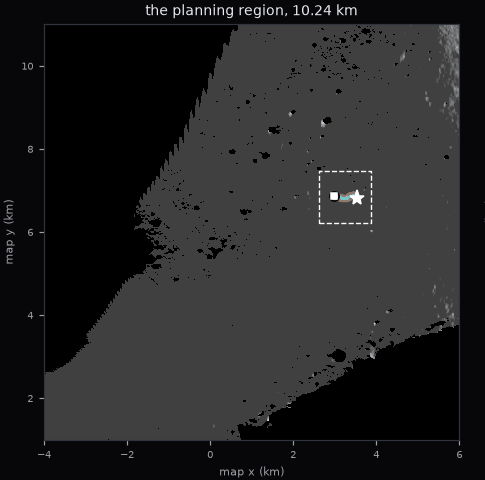
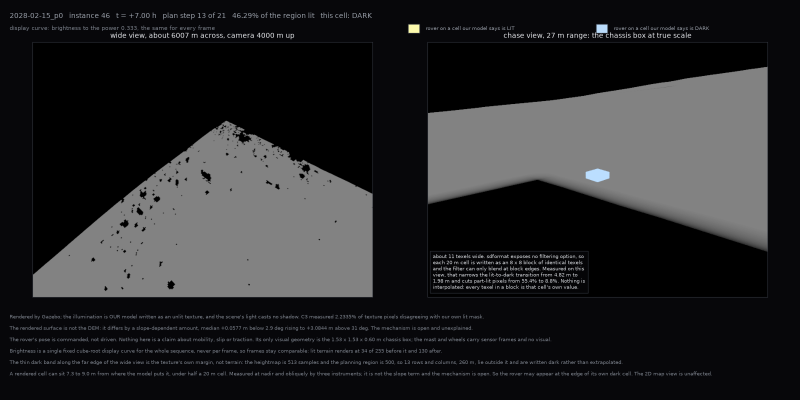

# lunar-polar-traverse

A time dependent path planner for a rover at the lunar south pole, on the real
LOLA 20 m DEM with a SPICE sun ephemeris, an independent C++ replay checker that
judges every plan, and an executive that watches the shadow budget while the plan
is being driven. The result splits: the illumination premise the method rests on
is measured and holds, the claim that plans ignoring time fail replay holds at
one of the two shadow budgets it was registered at and not the other, and the
payoff the method was supposed to buy is measured and does not appear.



*The 10.24 km planning region over the 12.13 h of one traverse, every frame at
the planner's own 0.25 h cadence. Grey is lit and black is dark, by our model
and not by Gazebo. The dashed box is the 1100 m window that Results shows close
up; the path inside it runs 404 m from start to goal.*

**In short.** Everything below was registered before it was measured, and it
reads after a correction that re-ran the whole pipeline, described in
[The correction, and what it changed](#the-correction-and-what-it-changed).
Shadow edges move at a median 172.69 m/hr, the same order as a slow rover, so a
path at this latitude is a schedule, and the illumination model behind that
figure agrees with the published permanent shadow map and with observed LRO
frames on measures a constant predictor cannot score. That half of the premise
holds. The other half, that plans ignoring time fail replay over long
traverses, is not passed: it holds at a 2 h shadow budget and fails its trend
clause at 0.5 h. Where a time dependent plan and a static baseline are both
feasible, the time dependent one arrives 0.14% earlier at the median against a
registered 10%. Paired per instance, the two planners' verdicts never disagree:
on all 221 instances where both produced a plan, the checker accepts both. What
the time dependent planner does differently is produce nothing where the
snapshot planner produces a plan the checker rejects, and on this data that is
mostly its search cap rather than a proof: of those 114 instances it proved 33
infeasible and ran out of time on 81.

## What is here

* An illumination model: per cell horizon profiles from the DEM, swept against a
  SPICE sun vector, turned into lit and dark intervals over a 720 h horizon.
  Written twice, once in C++ for the ray march and once in Python as an
  independent reference, because a single implementation of a convention tests
  nothing.
* An exact label setting search in time over a directed 8 connected graph. A
  state is (cell, arrival time, continuous shadow time) and waiting is allowed
  in lit cells only, which is what makes its dominance rule sound. It is label
  setting rather than label correcting because time strictly increases. The
  graph is directed because slope cost depends on heading: pitch along the
  direction of travel and roll across it, so A to B is not B to A. A time
  expanded graph exists in this repository but is not the planner: it is the
  reference that check 3 searches exhaustively to confirm optimality on small
  instances.
* Two baselines that are not strawmen: a snapshot planner that sees illumination
  frozen at departure, and a mean map planner that sees a time averaged lit
  fraction, swept over its weighting exponent and reported at its best setting.
* A replay checker in C++ that shares no code with the planner and integrates
  each plan against a finer sun table. It rejects 114 of the 343 snapshot plans
  on the core and 2 of the 66 time dependent plans at a 0.5 h shadow budget, and
  accepts all 226 time dependent plans at the core's 2 h. That it rejects
  anything is the only reason its acceptances are worth anything.
* An executive built on BehaviorTree.CPP with an independent auditor: it
  forecasts the shadow budget as the plan is driven, fires a control when
  continuing would bust, and replans at a lit cell. No ROS node runs and there
  is no ROS graph; the library is linked directly.
* A Gazebo Harmonic scene carrying the heightmap, a VIPER class rover model and
  our own illumination written as an unlit texture, used for a demo and for a
  checklist of eight verification items, not as a source of truth about
  illumination.
* A two artifact demo over one traverse: a 2D map view that is load bearing and
  a Gazebo view beside it.

Everything measured lives in this README or in the figures under `docs/`, and
every number here comes from a rerun of committed code.

## Results

The region is a 10 km square centred on map (1000, 6000) m in south polar
stereographic, 500 by 500 cells at 20 m, 6.08 km from the pole, 2296.6 m of
relief, 2.20% of it in permanent shadow by the published map. It was selected
by a rule registered before any illumination was computed, and the low shadow
fraction is a consequence of that rule rather than a goal of it.

### The premise, measured

Shadow edges outrun the rover. The median edge speed over cells whose caster
relief exceeds 20 m is 172.69 m/hr across 4504442 edges, against a registered
bar of 10 m/hr and a failure floor of 3 m/hr. That is what makes a path a
schedule rather than a route.

```bash
.venv/bin/python examples/score_p1.py
```

The illumination model agrees with two external references. Against the
published PSR map, recall on cells the map marks permanently shadowed is
99.7819% against a registered 70%, with a Matthews correlation of 0.8887
against 0.5. Against observed LRO NAC frames at the image epoch, agreement is
97.2030% against a registered 90%, at a threshold fixed by Youden's J on the
published simulation before our model was compared to anything. As with the PSR
check, the agreement figure is the weaker half: a predictor that marks nothing
shadowed scores 89.63% on the same pixels, so 90% is barely above the base rate
and it is Cohen's kappa, 0.8343 against a registered 0.6, that carries the
result.

```bash
.venv/bin/python examples/score_p5.py
.venv/bin/python examples/score_p6.py --image M139729686
```

Both of those have a weaker sibling that is reported as registered rather than
quietly dropped. The first registered agreement bar, 95% against the PSR map,
sits below what a model predicting no permanent shadow at all would score,
97.7996%, so passing it says nothing; the model's 99.4328% does clear that base
rate, by 1.63 points, which it barely did before the correction. The first NAC
bar used an Otsu threshold that assumes two modes; at 1.765 degrees of solar
elevation the lit pixels span a decade of I/F, Otsu splits steep lit from flat
lit terrain and marks 51.28% of pixels dark where the published simulation
marks 7.62% zero, so that check scores 56.9194% against 90% and no shadow model
of any quality could have passed it.

The other half of the premise is not passed. P2 predicted that at least 30% of
snapshot plans on traverses over 24 h replay as infeasible and that the
infeasible fraction rises with duration, and it was registered to be scored at
two shadow budgets, because the budget is what decides infeasibility and a
prediction about infeasibility rates cannot be scored at one budget alone. At
the core's 2 h it passes: 100 of 187, 53.5%, rising across duration quartiles
of 19.1, 32.6, 66.0 and 95.7%. At 0.5 h the fraction clears the bar, 37 of 57,
64.9%, but the quartiles run 42.9, 28.6, 85.7 and 100.0%, so the trend clause
fails, on quartiles of 14 cases where the dip is two instances. No rule
combining the two points was registered and none is invented, so P2 is
recorded as not passed. At 6 and 24 h the planner's 30 s cap decides most
instances and P2 is not scoreable there.

```bash
.venv/bin/python examples/score_phase3.py --parts core,p2axis,p7
```

### The check that mattered most

Before any of the above was worth reporting, the map projection was mirrored.
Snyder's south polar aspect is x = rho sin(LON) and y = rho cos(LON), so the
cosine goes with the x component; ours had the two interchanged, which maps
longitude L to 90 minus L and reverses handedness. Nothing internal could see
it. The C++ horizon and the independent Python ray march agreed to half a
float32 ulp because both were written from the same specification and were wrong
together, one frame check built its sun vector from our own frame, and a
sub-solar bearing check agreed with a published image to 0.07 degrees while
placing the region 20 km from where it belonged. What caught it was the first
reference in this project that came from outside it: Shackleton's centre from
the IAU Gazetteer of Planetary Nomenclature, located in the DEM as the centroid
of the largest closed depression below a stated contour and carried back through
our own map inverse, landed 20.39 km from the catalogue against a registered
1 km tolerance, and a mirrored convention had been predicted beforehand to
displace it 19.93 km. The cost of not running it would not have been a crash.
On the mirrored arrays P1's headline shadow edge speed was 28.31 m/hr; on the
corrected arrays it was 185.31 m/hr, both measured with the sun units fault
described next, so the claim this whole project rests on would have passed at a
sixth of the speed the corrected projection gave and the margin would have been
reported as comfortable.

```bash
.venv/bin/python -m pytest tests/test_landmarks.py -q
```

Three tests over two landmarks, Shackleton and Cabeus, six cases in all, which
skip on a fresh clone until `examples/fetch_data.sh` has fetched the DEM they
locate the craters in. Each tolerance is one third of that landmark's smallest
convention-fault displacement rather than anything about how precisely a
catalogue centre can be reproduced, and
`test_the_landmark_tolerance_discriminates` asserts that a mirrored or rotated
convention would actually fail it, because a test that cannot fail has not been
shown to work.

### The correction, and what it changed

Two defects were found after this README was first written, and two of its
claims were wrong: one stated a direction that had never been measured, and the
other quoted one planner's figure under another planner's name. Everything
downstream was re-run. No registered prediction was edited: each is scored again on the
corrected outputs, and the verdict before the correction stays beside the one
after it.

**What was wrong.**

1. *The sun was passed in kilometres.* SPICE returns the sun's position in
   kilometres, and seven of the nine places that fetch it passed that value into
   a frame decomposition whose cell origin is in metres. The parallax term was a
   thousand times too large, which put the sun 0.672 degrees too low at every
   cell and every epoch, between 0.657 and 0.674 over the epochs measured, and
   moved no azimuth at all: the cell origin is radial, so the error is in
   elevation only. The other two producers were shown to be unit safe rather
   than assumed to be. Found on 9 Oct 2026, while auditing this project's sun
   code for the follow-on project lunar-landing-gnc.
2. *The replay checker integrated the wrong length.* It divided the map-plane
   distance between cell centres by the rover's speed along the slope, so every
   step was short by the cosine of the pitch and every checker time since the
   checker was built came out early. Found on 22 Nov 2026, the first time the
   sign of the checker's arrival against the planner's was measured: the
   checker was earlier on 183 of 226 core plans, the opposite of what this
   README claimed. Before any code changed, the length difference alone
   predicted the gap plan by plan at a correlation of 0.846 over the core and
   0.980 at the 0.5 h point. The fix integrates along the surface, and an
   inclined-plane test that missed by exactly cos(theta) before it passes
   within 1e-4 after.
3. *"+1.169%, checker slower, confirmed in direction over 1949 plans."* The
   1.169% was the median of the absolute gap over the first 14 plans replayed.
   The script took `abs()`, so no direction was ever measured, and "slower" was
   the prediction from the convexity of time per metre in pitch, written beside
   a magnitude as though the batch had confirmed it. 1949 was not a count of
   plans. Measuring the sign is what exposed defect 2.
4. *"13.7% survival against 59.3%."* This README compared the time dependent
   planner with the snapshot planner at those two figures. The 13.7% was the
   mean map planner's replay survival, 197 of 1440, not the time dependent
   planner's. Found while tracing every number here to its source for this
   correction.

**Predictions registered for the correction, before it was applied.** The
correction was registered in the working record (see
[On the references to PLAN.md](#on-the-references-to-planmd-in-the-source)) as
entry D132, and its predictions keep that entry's labels: D132-1 to D132-3 were
registered before the sun fix, D132-4a and D132-4b before the checker fix. Each
is quoted as registered.

```
  D132-1   "P1's median FALLS."
           CONFIRMED      185.31 to 172.69 m/hr

  D132-2   "Lit fractions RISE at every epoch."
           NOT CONFIRMED  the 720 h mean lit fraction rose at all 12 epochs; the
                          lit fraction at departure rose at 10 and was exactly 0
                          before and after at 2. The wording did not say which
                          fraction.

  D132-3   "Feasible plan counts DO NOT FALL."
           VOID           the fix moved the pool the instances are drawn from,
                          so no instance is shared between the two runs to
                          compare

  D132-4a  "the checker is slower on more than half of them, so checker >
           planner on at least 114 of 226"
           PASS           172 of 226

  D132-4b  "at most 0.5 h, that point's shadow tolerance, against 7.7888 h
           before the fix", for the 0.5 h point's one bust
           PASS           0.3676 h
```

**Every prediction and check the correction re-scored, before and after.**

```
                              registered bar             before                   after
  P1   shadow edge speed      median >= 10 m/hr          PASS 185.31 m/hr         PASS 172.69 m/hr
  P2   snapshot infeasible    >= 30% over 24 h, rising   PASS at 2 h and 0.5 h    NOT PASSED: PASS at 2 h,
       over 24 h              with duration, at 2 and                             clause 2 FAIL at 0.5 h
                              0.5 h
  P3   arrival advantage      10% earlier in >= 25% of   FAIL 3.3% of 182,        FAIL 0.45% of 220,
       over the mean map      cases both resolve         median +0.51%            median +0.14%
  P4   no advantage under     median difference < 2%     PASS 0.04% on 44         PASS 0.00% on 48
       6 h
  P5   PSR map agreement      >= 95%                     PASS 97.9980%            PASS 99.4328%
  P5b  PSR recall, MCC        >= 70%, >= 0.5             PASS 99.8909%, 0.7158    PASS 99.7819%, 0.8887
  P6   NAC agreement, Otsu    >= 90%                     FAIL 58.8352%            FAIL 56.9194%
  P6b  NAC agreement, kappa   >= 90%, >= 0.6             PASS 97.1925%, 0.8493    PASS 97.2030%, 0.8343
  P7   advantage falls with   monotone over four rates   FAIL at the strict       FAIL at both readings
       rover speed                                       reading
  P8   executive              0 misses, unnecessary      FAIL on both rules       VOID on the corrected
                              <= 0.25, MCC >= 0.5                                 core, which has no bust
  arrival criterion           checker within 1% of       FAIL 43.3% of td plans   FAIL every planner,
                              planner                                             74 to 76% within 1%
  F2   label epoch sun        azimuth 5.25 within 1.0,   FAIL on azimuth 8.989;   FAIL on azimuth 8.989
                              elevation 1.10 within 0.1  elevation 1.105 passes   and on elevation 1.765
  G2   epoch scan azimuth     within 1.0 deg             FAIL 3.235 deg           FAIL 1.205 deg
  C3   Gazebo illumination    control kappa <= 0.5,      PASS, 2.6039% of         PASS, 2.2335% of
                              ratio >= 2                 pixels disagree          pixels disagree
```

P8's FAIL stands as the verdict on the sample it was registered on; on the
corrected data it has nothing to score. The arrival criterion's earlier FAIL
was measured on the defective checker. F2's azimuth did not move, as the fault
predicts, since it was in elevation only; its elevation clause passed only
because the label epoch's elevation had itself been measured with the fault.
F3, G1, H1 and check 1c use neither the sun position nor the checker, so the
correction could not move them, and they were not re-scored.

**What changed most: the executive.** On the corrected core no plan busts its
2 h budget, 0 of 51 monitored plans, where the first run had 4 of 45. P8, and
the paired test registered to judge any correction to the monitor, have no
positive class there and are void. What remains on the core is false-alarm
cost: the bounded contradiction rule fires on 34 of the 51 monitored plans and
the original rule on 44, and neither fires on any of 175 controls.

A successor condition registered before the axis runs moved the executive to the
0.5 h budget point, the only one of the ten points, the core and nine axis
points, at which any time dependent plan busts its budget. It is thin: two busts, 6
monitored plans that do not bust, and 58 controls. Both rules pass every bar
registered for it, firing on both busts and on no control. That pass separates
the executive from nothing. A rule that fires the moment the rover is in shadow,
which is the property the monitored set is selected on, scores exactly the same:
both busts, all 6 other monitored plans, no control. The bars were checked
against the two constant predictors and not against that rule. The lit-direction
correction removes 2 of the 6 false alarms there, a difference no outcome on 6
plans could make significant, and the learned model's arm was not run, because
its training fold, with every plan on the host's start and goal pairs removed,
held 64 and 59 disagreement episodes against a registered minimum of 60 in each
direction. The bounded rule's horizon was re-registered after each fix: from
0.725 h to 0.7105 h after the sun fix, on trajectories still integrated by the
defective checker, and to 0.7667 h after the checker fix. All three sit inside
the last one's own resampling spread. The demo's subject changed with it (see
[The demo](#the-demo)).

**What did not change.** The payoff is still absent and P3 still fails. Paired
per instance, the two planners still never disagree. P4 still passes and P6
still fails for the reason it always did. The illumination model still clears
both external references on the measures a constant predictor cannot score. G2
is still open, now at 1.205 degrees. The mirrored projection, the Gazebo
findings and the abort censoring are as they were.

**Two lessons.** A direction needs a signed measurement: "checker slower" stood
from September to November on a number that had been through `abs()`, and the
defect it hid was found the first time the sign was measured. And a bar has to be scored
against the trivial rule written from the sample's own definition, not only
against the constant predictors: on a sample selected by entering shadow, a rule
that fires on shadow passes by construction.

### The payoff, measured and absent

Where both the mean map plan, at its best exponent of 1.0, and the time dependent
plan are feasible, 220 cases, the time dependent plan arrives 0.14% earlier at
the median and clears the registered 10% margin in 1 case, 0.45%, against a
required 25%. On the checker's own arrivals the median is 0.03%. That
prediction fails by a wide margin on its own criterion, and the failure is not a
censoring artifact: it is scored on cases both planners resolved and the checker
judged. Its first clause, that the mean map baseline is feasible more often than
the snapshot, passes by one instance in 1440, 230 against 229, and reverses at
zero limit tolerance, 184 against 190, so it passes as registered and separates
nothing.

The regime where the method was predicted not to help behaves as predicted: on
traverses under 6 h the median arrival difference is 0.00% against a 2% bar, on
48 cases of median path length 9 cells, 180 m, the largest 3.78%, with the
vacuity caveat registered before the run.

A fourth prediction, that the advantage should shrink monotonically with rover
speed, fails at both readings. On the 32 cases feasible at all four speeds the
median advantage is exactly 0 at every rate: 24 of the 32 arrive at the
baseline's own time at 20, 50 and 200 m/hr. It is recorded as failed, not
revised.

```bash
.venv/bin/python examples/score_phase3.py --parts core,p2axis,p7
```

### What the planner actually buys, paired per instance

The aggregate looks like a feasibility difference: of 1440 instances the time
dependent planner produces 226 plans and the checker accepts all 226, while the
snapshot planner produces 343 of which 229 pass replay, 66.8%. Paired per
instance it is not an advantage of that kind at all. On the 221 instances where
both planners produced a plan, the checker's verdict is the same on every one:

```
  snapshot accepted, time dependent accepted   221
  snapshot accepted, time dependent REJECTED     0
  snapshot REJECTED, time dependent accepted     0
  snapshot REJECTED, time dependent REJECTED     0

  only a time dependent plan     5
  only a snapshot plan         122
```

Not once in either direction. Every one of the 114 snapshot plans the checker
rejected is on an instance where the time dependent planner produced nothing:
33 it declares infeasible and 81 it fails to solve within its 30 s cap. So the
honest statement is narrower than "it fixes the snapshot's mistakes", and
narrower than this README first made it. Where the time dependent planner
declines, it has proved there is no path in 33 cases and run out of search time
in 81, and whether it would rescue any of the 81 is unresolved. Which way those
81 would resolve is not measured. The one bound available is at another point
and does not support guessing: at the 6 h tolerance the snapshot planner aborts
on 113 of 160 instances, and since feasibility is monotone in the shadow
tolerance, at least 67 of those 113 are feasible.

```bash
.venv/bin/python examples/demo_traverse.py --stage select
```

### The executive, and what its bars could not show

On the corrected core the executive has no bust to catch: 0 of the 51 monitored
plans bust the 2 h budget. P8 is therefore void there, and its FAIL on the
sample it was registered on stands unrevised. That FAIL was a property of the
bars as much as of the monitor, and the reason is recorded rather than
explained away: at recall 1.0 and the 4 of 45 bust rate of that sample,
Matthews correlation is a function of the false alarm rate alone, so the 0.25
unnecessary bar and the 0.50 Matthews bar were the same constraint stated twice,
0.05 of false alarm rate apart, and a rule that genuinely achieves the target
clears the bar 54% of the time at that sample size and 75% at N = 2000.

The replacement, a paired McNemar comparison against the monitor with zero busts
lost, was registered before any candidate existed, and a gradient boosted
classifier on a ternary correction label was built and compared as registered,
whatever the baselines showed. With no bust on the corrected core that test is
void too, so the arms are reported as what they cost:

```
                            monitored  fired  controls fired  unnecessary
  bounded rule, no stream       51       34          0           0.6667
  B3b dark marks only           51       34          0           0.6667
  B3b-lit lit marks only        51       17          0           0.3333
  both directions               51       17          0           0.3333
  learned ternary model         51       23          0           0.4510
```

A two condition rule on the planner's own interval table, with nothing fitted,
removes 17 of the 34 false alarms; the learned model removes 11. Why the model
does worse is worth more than the fact that it does. The label is 97.75% zeros,
206413 of 211162 samples, so the model buys likelihood by predicting zero: its
accuracy on the region fold is 0.9835, the constant predictor scores 0.9783, and
the baseline that removes half as many false alarms again scores 0.9716. Any
bar on accuracy would have selected the worse component. The model was not
tuned further, because class weighting or a probability threshold would be
fitting against the plans it is scored on.

At the 0.5 h budget point, where the executive was moved to have busts to
catch, its registered bars pass and separate it from nothing, as
[the correction](#the-correction-and-what-it-changed) sets out: a rule that
fires on entering shadow scores identically.


On the demo's subject the bounded rule forecasts 3.31 h against the 2 h budget,
fires at 0.65 h, replans, and fires again at 1.29 h. With the lit-direction
correction the forecast peaks at 1.74 h and never fires. The world's own
continuous shadow on that plan peaks at 1.00 h, so both firings are false
alarms.

```bash
.venv/bin/python examples/run_executive.py
.venv/bin/python examples/score_correction.py
.venv/bin/python examples/traversability_model.py
.venv/bin/python examples/run_executive.py --host tol05
.venv/bin/python examples/score_correction.py --host tol05
.venv/bin/python examples/traversability_model.py --exclude-host tol05
```

### One epoch is one geometry

Solvability at this site is set by the lunation phase rather than by the date.
Across the twelve epochs the lit fraction at departure runs from 0.00% to
87.28%, and 208 of the 226 feasible time dependent instances come from three of
the twelve.


### The demo

One traverse, 2028-02-15 phase 0, instance 46, 21 cells over 12.13 h, selected
by rules registered before any candidate was examined. Two of the three rules
return empty sets on the corrected data and nothing was substituted for either:
the core contains no instance where the snapshot plan fails replay and the time
dependent plan passes, and no plan that busts its budget, so the panel that
would show the executive catching a bust states that it is empty. The subject is
the first of the 17 plans on which the bounded rule raises a false alarm that
the lit-direction correction removes. Two artifacts at the planner's own 0.25 h
cadence: a 2D map view that draws the model's arrays directly, and a Gazebo view
beside it. The full sequences are not tracked; the animation above and the
stills here are.

The 2D view at t = +0.75 h, the first frame after the bounded rule fires at
0.65 h. Left to right along the top: the 10.24 km region, then a 1100 m window on
the traverse with 10 m DEM contours, inside which the path runs 404 m from start
to goal, then the forecast against the 2 h budget with and without the
correction. Along the bottom: all twelve epochs, the world's own continuous
shadow with its resets, and the checker's verdicts for all three planners. The
plan holds at no cell: its 21 cells take 12.13 h of driving.




The Gazebo still is at t = +7.00 h, inside the world's 1.00 h dark run from 6.46
to 7.46 h, with the rover on a cell our model calls dark.

```bash
.venv/bin/python examples/demo_traverse.py --stage all
.venv/bin/python docs/make_figures.py
```

## Limitations

* **Abort censoring at large shadow tolerance and fast rates.** The planner is
  capped at 30 s per instance, and proving that no path exists is the expensive
  case, so unresolved instances are not missing at random. At the 100 and
  200 m/hr rates and the 6 and 24 h tolerances the cap decides 62.5% to 76.9% of
  instances, so the feasible counts there are lower bounds. On the core its share
  grew with the correction: of the 114 instances where the snapshot plan fails
  replay and the time dependent planner produces nothing, the cap decides 81,
  where the first run had 62 of 128. Two exact prunings, four shadow
  quantisation grids and a bounded measurement all failed to remove it. A
  relaxed dominance variant does remove it and is recorded unadopted, because it
  cannot certify infeasibility, which is the subject of the prediction it would
  have served.
* **The planner's summed edge times disagree with the checker's integration by
  more than the registered 1% on about a quarter of plans.** The criterion is
  stated per plan, that the checker's arrival must agree with the planner's to
  within 1%, with no rule for combining plans, so it is scored on every plan and
  fails for every planner: within 1% on 169 of 226 time dependent plans, 262 of
  343 snapshot plans and 74.4% to 75.8% of mean map plans. The checker is later
  on most plans, by a signed median of +0.30% to +0.39% by planner, which is the
  direction the convexity of time per metre in pitch predicts; the two
  integrations also differ in how they sample slope and roll, and the
  measurement does not separate the causes. The failure is about the bar, not
  the method: it says per-edge summation and continuous integration differ
  systematically and by how much, not that either is wrong. Every arrival time
  quoted here is the planner's own unless it says otherwise.
* **The replay checker would drop a hold at the start cell.** It applies each
  planner wait after the edge that reaches it and never reads the wait at the
  first cell. No plan here has one, 0 of 685 time dependent plans across the
  core and the axes and 0 of 13227 replayed plans of any planner, so no result
  is affected. The fix belongs with the next change to the checker.
* **Gazebo's rendered surface is not the DEM.** It differs by a slope dependent
  amount, a median of +0.0577 m below 2.9 degrees rising to +3.0844 m above 31
  degrees, correlated +0.6888 with slope and +0.0055 with the Laplacian. No
  mechanism is proposed. It bounds any height based check of the heightmap and
  destabilises the recovered map offset to about 5 m.
* **The illumination texture is misplaced in the Gazebo scene by 7.3 to 9.0 m**,
  under half a 20 m cell, in one dominant axis. Measured three ways including
  from straight down and with the reconstruction removed from the loop, so it is
  not a viewing artifact, and the rendered surface is within 0.35 m of the DEM at
  both features measured, so it is not the slope term either. The response to
  the texture size element is V shaped with the two axes preferring different
  values, and sdformat exposes a single scalar, so no value of it fixes both. The
  2D map view is unaffected.
* **A bearing offset of 1.205 degrees, unexplained.** The epoch scan that
  matches our shadow mask against the published simulated image puts its best
  fit 3.235 degrees of sun azimuth from the image's own geometry as first
  measured. 2.030 degrees of that was the sun units fault, which moved the fit
  and not the geometry, and 1.205 degrees remains against the registered 1.0, so
  G2 still fails. A residual rotation between our map and the products' frame,
  smaller than the roughly 18.3 degrees a crater centroid can detect, is the
  remaining candidate. Nothing excludes it, and closing it needs an external
  reference with better angular leverage than a landmark.
* **One mutation the test suite does not catch.** Replacing the 3 by 3 surface
  fit with central differences changes no test, and it is recorded as uncaught
  rather than papered over with a test written to catch that one mutation.

## Requirements

Developed and measured on Ubuntu 24.04 with Python 3.12.3.

Python, in a virtual environment:

```
numpy 2.5.2          scipy 1.18.1         matplotlib 3.11.2
rasterio 1.5.1       spiceypy 8.2.0       scikit-learn 1.9.1
joblib 1.6.0         pillow 12.3.0        pytest 9.1.1
```

C++: GCC 13.3, CMake 3.28 or newer, Eigen 3, and BehaviorTree.CPP 4.10 for the
executive. If BehaviorTree.CPP is not found, CMake warns and builds everything
except the executive; the horizon, the planner and the replay checker do not
depend on it.

For the Gazebo scene and the demo only, not for the planner, the executive, the
scoring or the tests. System packages:

```
gz-harmonic 1.0.0, with gz-sim8 8.15.0 and sdformat 14
ffmpeg 6.1, to encode the demo sequences
```

gz-common must be linked against GDAL or the heightmap will not load; the
packaged build on 24.04 is.

ROS 2 Jazzy is on this machine and three things come from it: BehaviorTree.CPP
4.10 at `/opt/ros/jazzy`, which the executive links against directly, and
`xacro` and `check_urdf`, which expand and validate the rover model in
`gazebo/`. Nothing in this repository imports ROS, no node runs and there is no
ROS graph, so any other source of those three would do. The CMake file finds the
header and the library by path rather than through the ament package config,
which pulls in a Python module that is not installed here.

Memory: the 20 m DEM is 30400 by 30400 float32, 3.7 GB. Nothing here opens it
whole, and 16 GB is enough.

## Setup

```bash
python3 -m venv .venv
.venv/bin/pip install numpy scipy matplotlib rasterio spiceypy scikit-learn joblib pytest
examples/fetch_data.sh
cmake -S cpp -B cpp/build && cmake --build cpp/build -j
```

`fetch_data.sh` is resumable and downloads about 3.5 GB into `data/`: the LOLA
20 m and 80 m polar DEMs and the PSR map from PGDA, 2.9 GB, nine LRO NAC frames
with their published simulated counterparts, 597 MB, and the SPICE kernels,
21 MB. Run outputs then take `data/` to about 9 GB. `data/` is not tracked.

A fresh clone with the virtual environment and the C++ build, but without the
data, runs the unit tests. The checks that need the real DEM, the Gazebo scene
or the sweep outputs skip themselves rather than failing.

## Running it

The stages are ordered and each writes into `data/work/` for the next. Times are
measured on a 16 thread desktop.

```bash
# region, DEM windows and the horizon field
.venv/bin/python examples/select_region.py
.venv/bin/python examples/extract_windows.py
cpp/build/horizon data/work/params.json                     # a few minutes

# cost model, edge speeds, lit and dark intervals at twelve epochs
.venv/bin/python examples/build_cost.py
.venv/bin/python examples/lit_intervals.py
.venv/bin/python examples/build_intervals.py --tag 2028-02-15_p0   # repeat per epoch

# the sweep: three planners over 1440 instances, every plan replayed twice
.venv/bin/python examples/sweep_core.py                     # about 58 min
.venv/bin/python examples/sweep_axes.py

# scoring
.venv/bin/python examples/score_p1.py
.venv/bin/python examples/score_p5.py
.venv/bin/python examples/score_p6.py --image M139729686
.venv/bin/python examples/score_phase3.py --parts core,p2axis,p7
.venv/bin/python examples/score_arrival.py

# executive, correction baselines, learned model; the core, then the 0.5 h point
.venv/bin/python examples/executive_sample.py --host core
.venv/bin/python examples/run_executive.py
.venv/bin/python examples/traversability_labels.py          # about 25 min
.venv/bin/python examples/traversability_baselines.py
.venv/bin/python examples/score_correction.py
.venv/bin/python examples/traversability_model.py
.venv/bin/python examples/executive_sample.py --host tol05
.venv/bin/python examples/run_executive.py --host tol05
.venv/bin/python examples/score_correction.py --host tol05
.venv/bin/python examples/traversability_model.py --exclude-host tol05

# Gazebo scene, verification checklist and the demo
.venv/bin/python examples/export_heightmap.py
.venv/bin/python examples/illumination_texture.py --tag 2028-02-15_p0
.venv/bin/python examples/verify_gazebo.py --parts c1,l2ppp,c2,c3,c4x,c5
.venv/bin/python examples/demo_traverse.py --stage all      # about 10 min
.venv/bin/python docs/make_figures.py
```

## Tests

```bash
.venv/bin/python -m pytest tests/ -q -rs
```

317 tests. Every test names the bug or invariant it protects rather than the
function it calls, and no test was added to raise a coverage number. Tests that
need data the run has not produced skip with their reason printed.

Every test here has been mutation checked: the code it guards is broken on
purpose and the test is required to fail before the test is believed. That is
not a formality, and this repository has the scars to show for it. A mutation
run reported a green result for a broken projection, because the write landed in
the same second as the baseline and CPython reused the stale bytecode; the
harness now runs `python -B` with every `__pycache__` removed, since many useful
mutations leave the file byte length identical. A later run reported five passes
that were the unmutated binary, because the patch anchor omitted a comment and
matched nothing; the harness now checks that each anchor matched exactly once
and says so when it did not. A mutation that fails to apply reports a green that
means nothing.

One mutation is recorded as uncaught, in Limitations above.

## Structure

```
cpp/src/        horizon ray march, edge speeds, the planner, the replay checker,
                the executive monitor. No shared code between planner and checker.
src/            illumination, intervals, cost model, planner, baselines, the
                replay and executive drivers, the auditor, the Gazebo mapping,
                the signed arrival gap.
examples/       one script per stage and one per scored prediction; the Gazebo
                verification checklist and the demo.
gazebo/         the rover model as xacro, every figure carrying its source or
                labelled an assumption.
tests/          317 tests, plus an independent Python horizon used as a second
                implementation rather than as a helper.
docs/           the figures this README embeds and the script that makes them.
data/           not tracked. Fetched products and run outputs.
```

### On the references to PLAN.md in the source

Docstrings and comments throughout refer to `PLAN.md`. That is the project's
working record: dated registrations made before each run, the reasoning behind
decisions, superseded values kept beside the ones that replaced them, and the
scored verdicts. It is kept privately rather than published, because most of it
is a log of what was tried and discarded and it would be read as documentation.

Every number those comments rely on is stated here. Where a comment says a value
was registered, the value itself is either on the line beside it or in the table
below.

| Registered value | What it fixes |
| --- | --- |
| region 10 km square centred on map (1000, 6000) m, 500 by 500 at 20 m | the planning region, chosen by a rule fixed before any illumination was computed |
| reach 238 km, near field 20 m switching to far field 80 m | how far a ray is marched, and where the resolution changes |
| 360 azimuth bins, 720 h horizon, 0.25 h sun cadence | the horizon profile and the interval tables built from it |
| twelve epochs, four dates by three lunation phases | the sun geometries everything is scored over |
| check 1c criterion 1.0e-3 deg | C++ horizon against the independent Python ray march |
| g cross-check tolerance 1e-6 deg | `cpp/src/edges.cpp` against `src/frames.py`, the third copy of the sun convention |
| sun chord error 3.5e-5 deg over 15 min | linear interpolation between sun samples, against the 1 deg ray spacing |
| check 3 inequality T_interval <= T_dt + 1e-9 h | the planner may never beat the time expanded reference |
| check 3 convergence: gap at most (path edges) times dt, monotone as dt halves, at dt 60, 30, 15, 7.5 and 3.75 min | replaced an earlier 1% clause that was arithmetically unreachable, and that clause stays scored as failed |
| planner port: identical arrival to 1e-9 h and identical path length on at least ten instances with a path | C++ planner against its Python original, swept over shadow tolerances 0.5, 2, 6 and 24 h |
| cost model: pitch to 1e-8 m of rise, decomposition at dip azimuth 23 deg | the slope cost against the raster and against closed form |
| shadow quantisation grids 1, 60, 300 and 900 s | the four tried against the abort censoring, none of which removed it |
| monitored configuration: 50 m/hr, 2 h shadow budget, pitch and roll limits 20 and 15 deg | the core's single point, at which the demo and the core executive results are measured |
| primary branch host: the tolerance 0.5 h axis point, its own 0.5 h budget; bars E-A, E-B (fire on each bust) and E-ctl (fire on 0 of 58 controls) | where the executive is scored once the core has no bust |
| replay limit tolerance 3.206 deg, and every plan judged again at zero | pitch and roll at the checker, judged twice on purpose |
| arrival criterion: checker's arrival within 1% of the planner's, per plan | scored on every plan, since no rule for combining plans was registered |
| planner cap 30 s per instance | the abort censoring in Limitations above comes from this |
| executive: 2 replans, declaration audit cap 6 at 300 s, contradiction horizon 0.7667 h | the tick budget and the audit that is independent of the executive; the horizon was 0.725 h, then 0.7105 h after the sun fix with the checker still defective, and was re-registered after the checker fix |
| McNemar test: same monitored plans, one sided exact p at most 0.05, zero busts lost | the registered bar any correction to the monitor is held to; void where there is no bust |
| learned model arm at the 0.5 h point: at least 60 disagreement episodes in each direction in the training fold | below it the arm is reported as not run |
| axis sweep: four epochs, one per date, 40 pairs each, 160 instances per point; rates 20, 100 and 200 m/hr, tolerances 0.5, 6 and 24 h, limit pairs (15, 10) and (25, 20) | one parameter varied at a time from the monitored configuration |
| bounded measurement: the first five 6 h and first three 24 h instances in draw order on which the exact engine aborted at an 8 s cap, rerun at 300 s | the sample rule behind the abort censoring result; eight of eight were still unresolved at 300 s, so the comparison it was meant to enable could not be made and the fallback was triggered |

## License

The code in this repository is MIT licensed. See `LICENSE`.

This repository contains no third party terrain, imagery or kernels. `data/` is
not tracked and `examples/fetch_data.sh` downloads everything at run time from
the sources below.

* **LOLA DEMs and the PSR map**, the 20 m and 80 m south polar adjusted DEMs and
  the 20 m permanent shadow map, from the NASA Planetary Geodesy and Geophysics
  Data Archive at GSFC, product 90.
  <https://pgda.gsfc.nasa.gov/products/90>
  That page states no licence and no use restriction. Its Data Usage Policy
  states one requirement: "Please cite this paper when using these products:
  Barker et al., 2023 Planet. Sci. J., 4, 183." Paper DOI 10.3847/PSJ/acf3e1,
  data DOI 10.60903/gsfcpgda-lola-spole.
* **LRO NAC frames and their simulated counterparts**, nine image identifiers
  map projected onto the same 20 m DEM, fetched from the same PGDA product page
  and so under the citation requirement above. The underlying imagery is LROC's,
  whose own terms apply to it.
  <https://www.lroc.asu.edu/about/terms>
  Those terms state that "Data products available through the LROC Data Node of
  the PDS or through NASA PDS interfaces are in the public domain", while images
  from the LROC website itself "are copyrighted" and commercial use of images
  not downloaded from the LROC PDS archive requires prior permission. The
  required credit is the text tag "NASA/GSFC/Arizona State University", or
  "NASA/GSFC/ASU" where space is limited. No formal licence such as Creative
  Commons is named.
* **SPICE kernels**, the DE421 planetary ephemeris, the lunar PA binary PCK, the
  leapseconds and planetary constants kernels and the LRO spacecraft clock
  kernel, from NAIF at JPL.
  <https://naif.jpl.nasa.gov/naif/rules.html>
  NAIF names no licence. It states that "Redistribution of SPICE kernels
  distributed by NAIF is permitted as long as they have not been modified", that
  a modified kernel must carry "the name and institution of whomever has made
  the last modification", and that acknowledgement of SPICE or NAIF resources
  "is encouraged" rather than required. Commercial use is allowed subject to
  restrictions on user support. Nothing here modifies a kernel, and none is
  redistributed: `fetch_data.sh` downloads them from NAIF at run time.

The rover model under `gazebo/` is written here from published descriptions and
is not a redistribution of anyone's model. Its dimensions are a VIPER class
envelope, its stereo and hazard camera parameters come from the published Mars
Science Laboratory engineering camera description, and its LiDAR is a deliberate
departure from the class, labelled as one in the file. Every figure in it either
carries its source or is marked an assumption.
